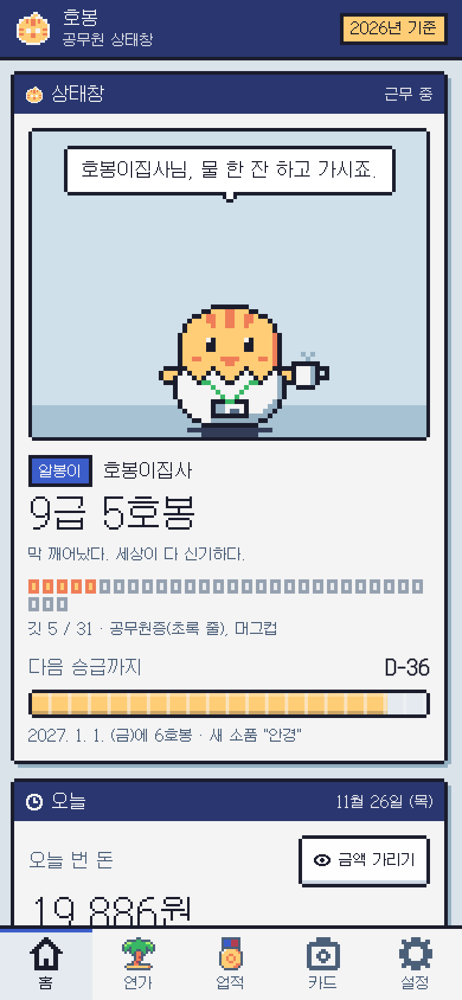
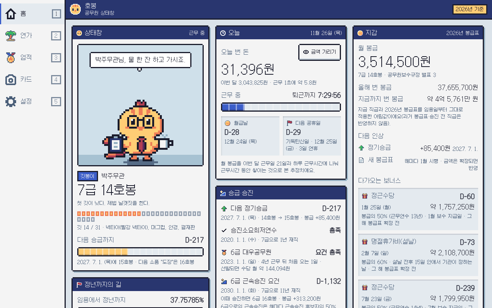
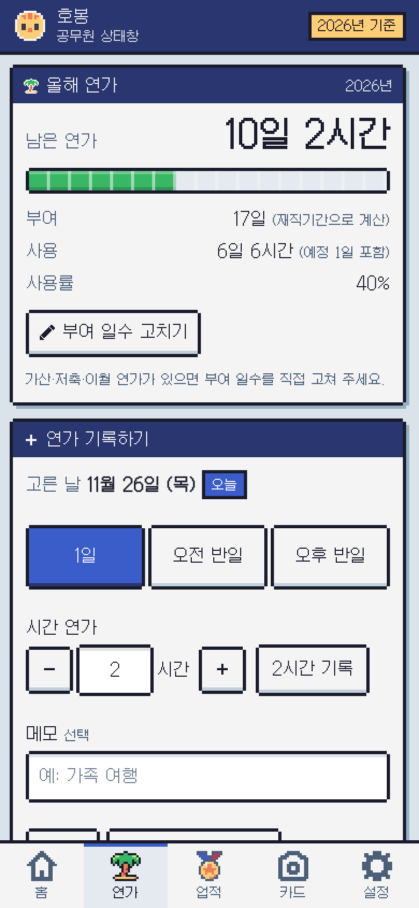
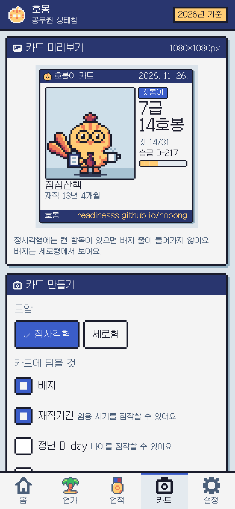
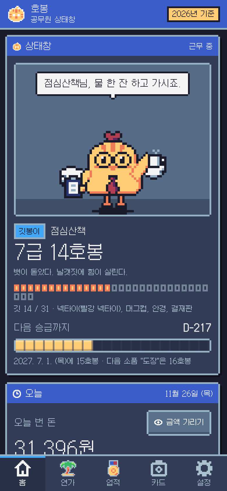

# 호봉 (hobong)

[](https://github.com/readinesss/hobong/actions/workflows/ci.yml)

공무원이 자기 **호봉·월급·승급·연가·정년**을 재미있게 확인하는 픽셀아트 웹사이트입니다.
호봉이 오를 때마다 자라는 캐릭터 **호봉이**가 함께합니다.

- 서버가 없습니다. 모든 계산은 브라우저 안에서 합니다.
- 외부로 나가는 요청이 **0건**입니다. HTML 파일 하나로 인터넷이 막힌 업무망에서도 그대로 동작합니다.
- 입력한 값은 그 브라우저(localStorage)에만 남습니다. 실명·소속은 묻지 않습니다.
- 숫자는 코드가 아니라 [`data/<연도>.json`](data/)에 **근거 법령·조항·시행일**과 함께 들어 있습니다.

| 모바일 | 데스크톱 |
|---|---|
|  |  |

| 연가 장부 | 캐릭터 카드 | 야근 모드 |
|---|---|---|
|  |  |  |

## 쓰는 방법

| 어디서 | 방법 |
|---|---|
| 인터넷이 되는 곳 | <https://readinesss.github.io/hobong/> 을 엽니다 |
| 업무망(인터넷 차단) | [최신 릴리스](https://github.com/readinesss/hobong/releases/latest)의 `hobong.html` **한 파일**을 옮겨 브라우저로 엽니다 |

릴리스가 아직 없다면 [Actions의 CI 실행](https://github.com/readinesss/hobong/actions/workflows/ci.yml) → Artifacts → `hobong-html` 에서 같은 파일을 받을 수 있습니다.

처음 열면 **새로 시작**과 **데이터 불러오기**가 나란히 있습니다. 임용일·생년월일·직급·호봉·다음 승급일·닉네임을 넣으면 끝입니다.
PC를 바꾸거나 브라우저 저장소가 지워질 때를 대비해 **설정 → 데이터 내려받기**로 백업 파일을 받아 두세요.

## 무엇을 보여주나

| 화면 | 내용 |
|---|---|
| 홈 | 오늘 근무 진행률과 **오늘 번 돈**(초 단위), 퇴근·월급날·다음 공휴일, 다음 승급 D-day, 월 봉급과 다음 인상, 정근수당·명절휴가비 D-day, 정년까지, 근속승진·대우공무원, 다가오는 일정 |
| 연가 | 한 번 눌러 기록(1일·반일·시간), 부여 일수 자동 계산과 직접 수정, 남은 연가, 달력, 월별 현황, 징검다리 찾기, 연가보상비 1일 단가, 장기재직휴가 안내(쓸 수 있는 기간·기한) |
| 업적 | 근속·승급·연가·기록에서 저절로 받는 배지, 호봉이 도감, 출근 도장을 찍는 1년 픽셀 달력 |
| 카드 | 캐릭터 카드와 올해 결산 카드를 PNG로 저장·복사·공유(정사각형·세로형), 붙여넣기용 글자 카드. 금액은 켤 때만 들어갑니다 |
| 설정 | 내 정보, 근무시간·월급날, 야근 모드, 금액 가리기, 데이터 내려받기(암호 걸기 선택)·불러오기·되돌리기, 제안·문의, 호봉이의 꿈(앞으로 만들고 싶은 것), 근거 법령, 오픈소스 고지 |

호봉이는 직급에 따라 모습이 바뀌고(알봉이 → 솜봉이 → 깃봉이 → 날봉이 → 봉황), 호봉이 쌓이면 소품이 늘어납니다.
방치해도 죽거나 퇴화하지 않습니다. 오래 쉬지 못했으면 말없이 지친 얼굴을 할 뿐입니다.

## 알아 두세요

- 금액은 **봉급표 기준 추정치**입니다. 수당·세금·기여금이 빠져 있어 실수령액과 다릅니다.
- 연가 장부는 **참고용**입니다. 공식 인사시스템의 기록이 기준입니다.
- 휴직·징계·경력 인정처럼 사람마다 다른 사정은 계산하지 않습니다. 해당 날짜를 직접 넣어 보정할 수 있습니다.
- 지금은 **국가직 일반직 공무원** 기준입니다. 지방직 등은 근거 규정이 달라 아직 지원하지 않습니다.
- 파일(hobong.html)로 열어 쓰면 같은 PC·같은 브라우저로 여는 다른 HTML 파일과 브라우저 저장소를 함께 씁니다(Chrome·Edge의 file:// 동작). 출처를 모르는 HTML 파일은 같은 브라우저로 열지 말고, 예전 hobong.html 사본은 지워 주세요.
- Chrome·Edge 88, Firefox 78, Safari 14.1 이상(2021년 이후 버전)을 대상으로 만들었습니다. 자동 검증은 최신 Chromium·Firefox·WebKit에서 합니다.
- 정부나 어떤 기관과도 관계없는 비공식 도구입니다.

## 숫자의 근거

봉급표, 연가 일수, 승진 요건, 공휴일 같은 값은 모두 국가법령정보센터의 원문으로 확인해 넣었고,
확인한 원문 발췌본을 [`docs/sources/`](docs/sources/)에 남겼습니다. 테스트가 데이터와 발췌본을 대조합니다
(봉급표는 한 칸도 다르면 실패합니다). 앱의 **설정 → 근거 법령**에서도 항목별 조항과 개정일을 볼 수 있습니다.

법령이 바뀌면 `data/<연도>.json` 만 고치면 됩니다. 방법은 [규정 데이터 갱신 가이드](docs/DATA.md)에 있고,
매달 도는 점검 워크플로가 손봐야 할 것을 이슈로 알려 줍니다.

규정 값이 틀렸거나 바뀐 것을 발견하면 [법령·규정 변경 제보](https://github.com/readinesss/hobong/issues/new?template=rule.yml)로 알려 주세요.

## 제안·문의 메일과 호봉이의 꿈

설정 화면의 **제안·문의** 창은 [`data/site.json`](data/site.json)의 `contactEmail` 을 보여 줍니다.
비워 두면 "메일 주소를 준비하고 있어요"만 보이고 메일 버튼은 숨습니다. 주소를 넣고 다시 빌드하면 됩니다
(`npm test` 가 주소 형식을 검사합니다). 앱은 메일을 보내지 않습니다. 주소를 보여 주고 복사하게 하거나,
사용자의 메일 프로그램을 열 뿐입니다.

같은 파일의 `dreams` 가 **호봉이의 꿈**(이룬 꿈·자라는 중·꾸는 꿈)입니다. 약속이 아니라 꿈이라 날짜는 적지 않습니다.

## 외부 요청 0건을 지키는 방법

약속이 아니라 구조로 막습니다.

1. 빌드 결과가 **파일 하나**입니다. 글꼴·그림·데이터가 모두 그 안에 들어 있습니다.
2. 빌드할 때 [`scripts/postbuild.mjs`](scripts/postbuild.mjs)가 외부 참조와 네트워크 API가 없는지 검사하고,
   **보안 정책(CSP)** `default-src 'none'; connect-src 'none'` 을 넣습니다. 코드가 통신을 시도해도 브라우저가 막습니다.
3. 종단 테스트가 그 파일을 `file://` 로 열어, 문서 자신 말고는 아무것도 요청하지 않는지 확인합니다.

## 개발

Node.js 22.12 이상이 필요합니다.

```bash
npm ci
```

```bash
npm run dev
```

| 명령 | 하는 일 |
|---|---|
| `npm run dev` | 개발 서버 |
| `npm run build` | 단일 HTML 빌드(`dist/index.html`, `dist/hobong.html`) + 외부 참조 검사 + CSP |
| `npm test` | 단위 테스트(계산, 규정 데이터, 저장·변환, 캐릭터, 업적) |
| `npm run test:e2e` | 빌드한 파일을 `file://` 로 여는 종단 테스트(먼저 `npm run build`) |
| `npm run verify` | 린트 · 포맷 · 타입 · 단위 테스트 · 빌드를 한 번에 |
| `npm run rules:check` | 규정 데이터가 낡지 않았는지 점검 |
| `npm run sprites:preview` | 도트 그림(글자 격자)을 PNG로 미리 보기 |

```
data/            규정 데이터(<연도>.json), 캐릭터 진화 규칙, 한마디
docs/            기획(PLAN·IDEAS), 데이터 갱신 가이드, 법령 발췌본
src/lib/calc/    계산(순수 함수): 날짜, 정년, 승급, 봉급, 연가, 승진, 보너스, 일정
src/lib/rules/   규정 데이터 읽기·연도 합치기·낡음 점검
src/lib/store/   저장 형식, 검증, 구버전 변환, 백업
src/lib/character/  도트 그림 형식·합성, 진화 규칙
src/screens/     화면
src/assets/      글꼴, 도트 그림(글자 격자)
tests/           단위 테스트, 종단 테스트
```

계산은 화면과 분리된 순수 함수이고, 날짜는 시간대 없는 `YYYY-MM-DD` 문자열로 다룹니다.
도트 그림은 PNG가 아니라 글자 격자(`src/assets/sprites/*.txt`)여서 그림 도구 없이 고치고 변경 내역을 볼 수 있습니다.

## GitHub 자동화

| 워크플로 | 언제 | 하는 일 |
|---|---|---|
| [CI](.github/workflows/ci.yml) | 푸시·PR | 린트·포맷·타입·단위 테스트·빌드 뒤 Chromium·Firefox·WebKit에서 종단 테스트. `hobong.html` 을 Artifacts로 |
| [Pages 배포](.github/workflows/pages.yml) | 기본 브랜치 푸시 | 단일 HTML을 GitHub Pages로 (Settings → Pages → Source: GitHub Actions 를 켠 뒤부터) |
| [릴리스](.github/workflows/release.yml) | 태그 `v*.*.*` 또는 수동 | `hobong.html` 과 체크섬을 Release에 첨부 |
| [규정 데이터 점검](.github/workflows/rules-watch.yml) | 매달 | 새 봉급표·다음 해 공휴일 등 손봐야 할 것을 이슈로 |
| [CodeQL](.github/workflows/codeql.yml) | 푸시·PR·매주 | 코드 보안 점검 |
| [라벨 맞추기](.github/workflows/labels.yml) | 라벨 정의 변경 | `.github/labels.json` 대로 라벨 생성·수정 |

의존성은 Dependabot이 매주(npm)·매달(액션) 올립니다.

## 문서

- [`docs/PLAN.md`](docs/PLAN.md) — 프로젝트 브리프와 결정 기록
- [`docs/IDEAS.md`](docs/IDEAS.md) — 기획 조사와 아이디어(채택·보류와 그 근거)
- [`docs/DATA.md`](docs/DATA.md) — 규정 데이터 갱신 가이드
- [`THIRD_PARTY_NOTICES.md`](THIRD_PARTY_NOTICES.md) — 포함된 글꼴·라이브러리 고지

## 고지

글꼴 [Galmuri](https://github.com/quiple/galmuri)(SIL OFL 1.1)와 [Svelte](https://svelte.dev)(MIT)가 결과물에 들어 있습니다.
자세한 내용은 [THIRD_PARTY_NOTICES.md](THIRD_PARTY_NOTICES.md)를 보세요.
